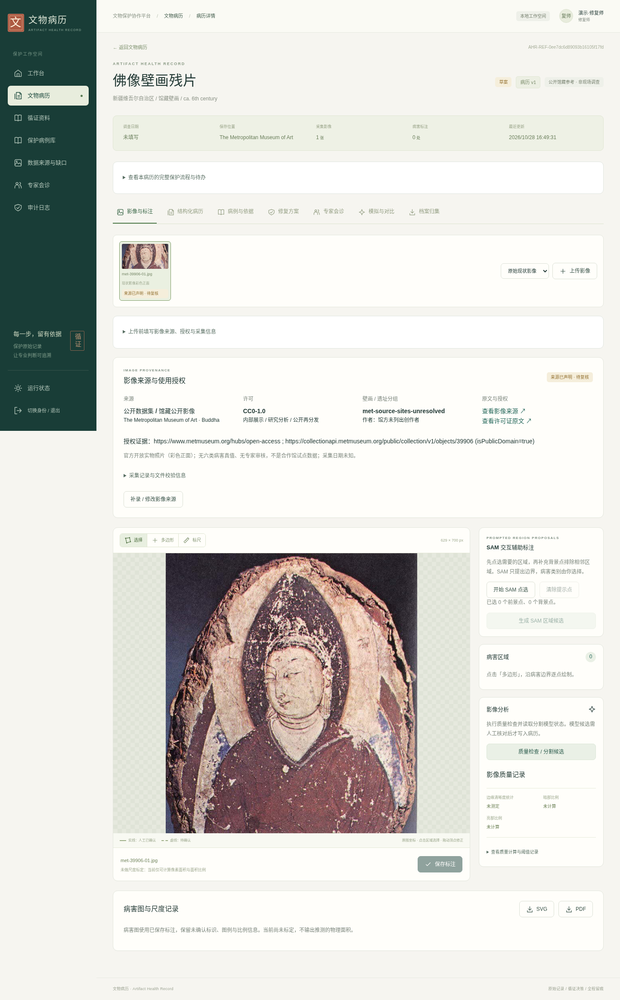
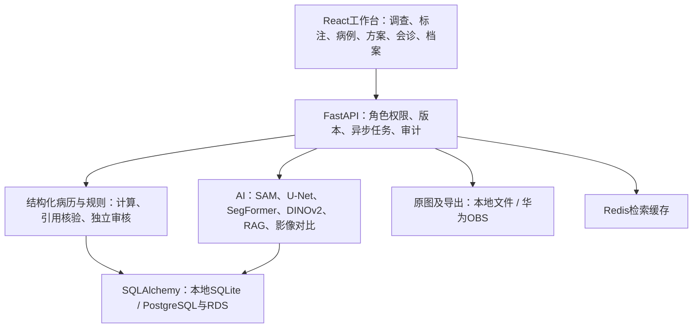

# 文物病历 · Artifact Health Record

壁画保护的循证工作台：采集与来源登记 → 病害标注 → 结构化病历 → 病例检索 → 13部分方案 → 规则检查 → 专家会诊 → 修复档案。按《方向一_文物病历_比赛构建指南_V1.0》逐项补齐，保留完整 React、FastAPI、数据库、AI、规则和归档工程。

本次交付分支：[xqw-v0](https://github.com/Xlovlhj/ArtifactHealthRecord/tree/xqw-v0)。**27张官方开放的实物照片已随代码提供，属于18件馆藏对象（14张彩色正面、5张黑白正面、8张背面/装裱结构）；六类病害专家标注仍为0，完整授权修复病例仍为0，真实准确率尚未产生。** 公开图、教学图、真实现场资料分别登记，不以图库数量代替试点或训练成果。

[Word交付与后续工作](docs/ArtifactHealthRecord_xqw-v0_交付与后续工作.docx) · [项目书验收矩阵](docs/guide-implementation-matrix.md) · [数据和模型](docs/model-and-data.md) · [实际验证记录](docs/xqw-v0-validation.json)

## 运行

安装 Miniconda，进入项目目录：

```console
python3 run.py setup --with-ai
python3 run.py verify
python3 run.py
```

打开 **http://127.0.0.1:8765**。`run.py` 自动使用项目内 `.conda` 环境；首次安装需网络，之后基础工作流可离线使用。`--with-ai` 安装完整固定版本的 PyTorch CPU、torchvision、SMP、Transformers 依赖；模型权重另行显式下载。没有 `.sh` 启动器。基础环境可省略 `--with-ai`，保留人工标注与完整业务流程。

本机已有环境，SAM与DINOv2已在本地`.env`中指向现有权重（该文件不上传Git）；真实病害分割仍待训练。直接运行：

```console
python3 /home/xqw/xqw-file/HRF/ArtifactHealthRecord/run.py
```

本地演示密码为 `ahr-demo-2026`，初始化凭据另存 `runtime/demo-access.json`。生产使用独立数据库和自行设置的强密码，不能复用演示身份。

| 账号 | 身份 | 主要能力 |
| --- | --- | --- |
| surveyor | 调查员 | 建档、采集、标注、登记来源 |
| restorer | 修复师 | 编写方案、提交、沟通模拟 |
| expert | 会诊专家 | 来源复核、批注、审核其他人的方案 |
| manager | 管理者 | 统计、查阅、获授权导出 |
| admin | 管理员 | 账号、数据与导出审批；不代替专家签字 |

建议用 `restorer` 登录，先打开“真实壁画参考图库”，查看馆方出处并导入一件参考病历，再进行标注和调查；缺少的年代、检测、标尺等按未知保存。原来的3份程序绘制教学样板保留用于流程回归，标为合成，不能作为真实病害证据。



更多实际界面：[工作台](docs/screenshots/01-dashboard-desktop.png) · [标注](docs/screenshots/02-annotation-desktop.png) · [方案](docs/screenshots/03-plan-desktop.png) · [会诊](docs/screenshots/05-review-desktop.png)

## 保留并接通的完整能力

- **采集与来源**：原始文件和方向规范化显示图分别存储；逐图来源、作者、许可、允许用途、采集日期、原址分组、哈希、复核人和复核时间；来源变更撤销原复核。公开图库27张JPEG原件与18份官方元数据一并交付。
- **病害图**：六类病害、人工多边形及编辑、实测尺度与面积；SVG/PDF使用图符包。裂隙中心线由人补录，缺失时明确提示。程序未代替专家图件验收。
- **SAM辅助标注**：前景/背景点击、异步候选、掩膜预览、人工选类；任务绑定病历版本和图像哈希。通用SAM分割区域不等于六类疾病识别。复杂多区域或孔洞需人工处理。
- **学习模型**：紧凑U-Net、预训练ResNet34 U-Net、SegFormer；二分类/六类训练、冻结编码器、迁移、滑窗推理、按原址分组、五折评估；无真实病害权重时明确显示不可用。
- **预处理**：保留原图，EXIF校正、提供色卡后校色、提供内参后去畸变、拼接、切片及派生清单；未提供标定数据不编造校正参数。
- **病历与病例库**：调查、既往处置、检测、鉴别诊断、风险、随访；病例新建、编辑、附件、出处、复核、选入证据和快照；公开新闻摘要与完整病例区别显示。
- **循证检索**：中文BM25、结构化筛选、可选远程embedding、本地DINOv2/CLIP图像检索；缺模型/服务时显示实际回退路径。
- **方案与审核**：13部分方案、可编辑版本、逐节引用、材料试验、预算算术、规则检查、独立专家审核；旧病历/旧方案不能继续审批，作者不能自审。
- **模拟与对比**：默认明确标识的OpenCV插值；保留LaMa/SD适配。永久水印、独立存储，前后照片配准与差异图不冒充修复成效。
- **档案与安全**：10类档案、过程记录与附件、PDF/JSON/ZIP、原始影像与清单、敏感导出审批、机构隔离、完整操作审计和数据库增量迁移。
- **评测**：E1分割指标与五折汇总；E2–E6真实采集表、标注一致性、检索、盲评、计时/SUS、配对比较、置信区间。空数据保持空值。

## 真实数据到底有什么

| 数据 | 实际数量 | 用途和缺口 |
| --- | --- | --- |
| The Met开放壁画照片 | 27张 / 18件馆藏对象 | CC0，随仓库提供；中国壁画、含山西/新疆等，不替代甘肃目标域；无病害真值 |
| 本机已有敦煌研究GT裁片 | 60张 / 原始来源保守同组 | 仅在本机runtime保留；“GT”指原研究图像任务，不是本项目六类标签；权利链未充分核实，不上传 |
| MuralDH完整包 | 0份 | 已有元数据与官方下载程序，现有访问记录401/403；取得后仍需重核类别映射 |
| 程序化教学样板 | 3份 | 软件演练，不进入真实效果统计 |
| 六类专家标注 / 完整授权病例 / 真实试点 | 0 / 0 / 0 | 必须通过单位合作、采集、专家审核补齐 |

公开参考图入口：[manifest.json](data/public/mural_reference/manifest.json)。每张含馆藏编号、来源链接、原件SHA、尺寸、对象分组及官方许可凭据；同一物件的多个视图不算多件文物。公开参考图不自动成为训练数据。

## 配置真实模型

复制 `.env.example` 为 `.env`，按实际资源填写。显式取得通用权重：

```console
python3 run.py script fetch_models.py --models dinov2 sam resnet34
```

`run.py script`自动切换到项目Conda解释器，无需激活当前终端。设置：

```ini
AHR_SAM_MODEL_DIR=runtime/models/sam-vit-base
AHR_RETRIEVAL_MODEL_DIR=runtime/models/dinov2-small
AHR_RETRIEVAL_BACKEND=dinov2
AHR_SEGMENTATION_CHECKPOINT=
```

前三项启用通用辅助边界与视觉检索。最后一项需要**真实数据训练并独立验证的六类病害权重**，不能填入SAM、DINOv2或合成冒烟权重。模型版本和固定文件SHA由下载程序记录。

LLM、VLM和embedding使用兼容服务配置。只有设置 `AHR_ALLOW_EXTERNAL_MODELS=true` 才允许外发病历；没有凭据时返回明确模板/人工路径。RDS、Redis缓存、OBS、MaaS和容器配置保留，详见[部署说明](docs/deployment.md)。本轮未购买云资源、未宣称实际接通华为云或使用CodeArts。

## 架构



## 验证与复现

```console
python3 run.py doctor
python3 run.py test
python3 run.py build
python3 run.py verify
python3 deploy.py package
```

`verify` 离线核对工程文件与公开样例原图哈希；`doctor` 区分配置和实测。浏览器端到端检查：在项目环境安装 `playwright` 后执行 `python3 frontend/tests/browser_smoke.py`，使用系统Chromium或 `python3 -m playwright install chromium` 下载的浏览器。它启动隔离临时数据库，不改现有记录。

本轮准确测试数量、命令与数据范围见 [xqw-v0-validation.json](docs/xqw-v0-validation.json)；此前的 `validation*.json` 为历史检查。测试通过证明工程路径，不代表病害Dice、方案采纳率、SUS或文保专业认证。

## 原有实现与本次修改

保留既有前后端、六类模型训练、13节方案、材料规则、会诊与10类档案，不删减成演示页面。本次增加公开真图和来源治理、图符实际渲染、SAM主流程、病例附件保留和复核、公开数据验收、完整AI环境安装及发布过滤；修复NPZ标注未绑定清单哈希的问题。未擅自改换病害算法、损失权重或专业阈值。

项目书中的数据量、Dice、试点与效率是验收目标，不是本项目成绩。后续工作及完成依据见Word。团队姓名、合作单位、云资源与实测分数必须由实际参与者补入。

代码：[MIT](LICENSE)。数据和模型各按上游授权；公开参考图为馆方CC0。详见 [第三方资产](THIRD_PARTY_NOTICES.md)。
