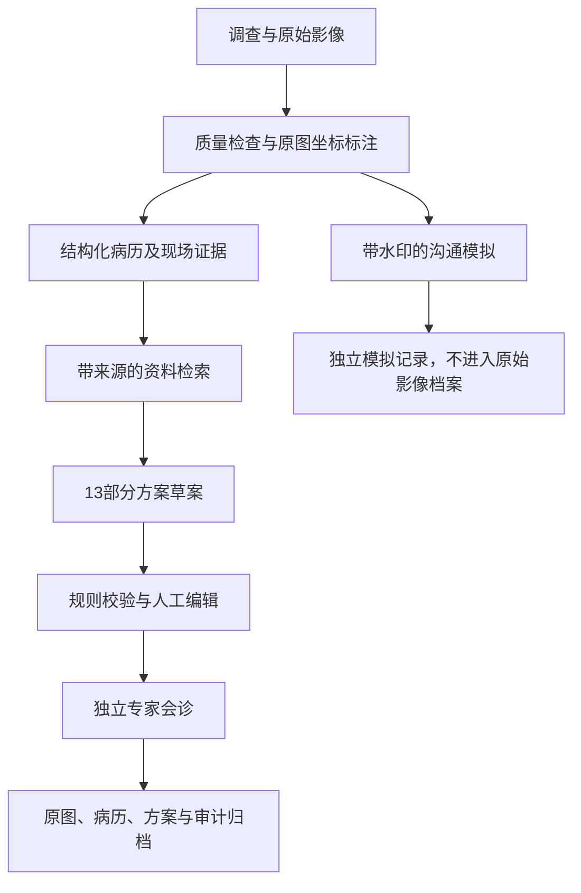

# 架构与数据流

系统把“看见了什么”“推测是什么”“准备怎么处理”“谁审核过”分别记录。影像是事实来源，标注是可修正的观察，模型只给候选，方案保持草案性质，审核绑定具体版本。某一步资料不足，后续页面会保留未知状态。

## 运行组件

React通过同源 `/api/v1` 访问FastAPI，登录凭据为HttpOnly Cookie；API工具可用Bearer令牌。SQLAlchemy维护业务表，本地SQLite启用外键与WAL；云端可使用PostgreSQL。图像由鉴权接口读取，底层选择本地文件或私有OBS，客户端不取得存储密钥。Redis仅缓存检索。

AI服务在需要时加载，缺少torch或权重不影响人工流程。图像质检、几何、配准、默认插值使用Pillow/OpenCV/NumPy。训练和评估与Web进程分离，通过含标签、数据来源及模型配置的checkpoint接入。冒烟权重不能被Web启用为真实诊断模型。

文本生成、视觉抽取和embedding都是可选的兼容HTTP接口。所有外部调用要求明确配置和外发许可。生成前取可信来源ID，生成后验证章节、数据类型和引用范围，失败回退到明确标记的模板。没有宣称ID校验能判断自然语言结论是否被引用支持。

## 主要实体

| 实体 | 作用及关联 |
| --- | --- |
| User / AuthSession | 机构、角色、密码哈希、会话有效期；返回信息不包含密码哈希 |
| Artifact / Survey / Record | 文物基本信息、一次调查和病历事实；Record有内容版本 |
| ImageAsset / Disease | 影像原始哈希、规范化尺寸、标尺；病害多边形、来源和现场证据 |
| CaseReference | 已导入公开案例摘要的登记快照；检索以版本化JSON来源库为准 |
| Plan / PlanCheck | 方案内容版本、生成时病历快照、来源、检查结果及内部审批状态 |
| Consultation | 批注、审核决定、账号身份及绑定内容哈希 |
| Simulation / Job | 独立模拟文件、任务状态、提交时原图哈希与病历版本 |
| AuditLog | 操作者、动作、前后值、规则/标准版本及哈希链接 |

## 一致性约束

病历内容修改、影像上传、标尺和标注更新会递增病历版本，使已有待审或已批准方案失效；提交审核和审核本身不改变事实版本。方案编辑创建新方案版本，不能覆盖旧内容。方案记录生成时的病历快照，旧PDF使用该快照，因此后来的更名不会改写历史背景。

提交要求最新方案、当前病历版本、无阻断规则；审核要求独立专家账号、精确匹配的账号姓名、提交时内容哈希、仍然当前的事实版本。人工确认记录是机构内部审批，未接CA签章系统。

数据库写入先锁Record，再锁Plan；另外使用乐观版本检测和唯一方案版本约束。目标PostgreSQL的并发验收仍需独立进行。原始影像不可被模拟覆盖；完整ZIP要求原始字节存在，缺失返回409。

标注几何在服务端检查越界、自交、重复顶点和非有限数，面积用鞋带公式计算。若标尺长度为L厘米、像素距离为d，则 `area_cm2 = area_px × (L/d)^2`。该换算假定近似平面和尺度一致；不同影像面积不能直接相加当作文物总病害面积。

人工标注没有模型置信度；模型标注必须匹配该影像已完成任务的候选序号、类别和多边形，置信度取服务端结果。前端修改候选形状或类型会转为人工来源。空鼓的“确认”还须填写现场证据，不能靠照片或模型置信度越过。

## 原方案与工程选择

保留原指南U-Net/SegFormer与13节结构。当前默认分割网络为紧凑U-Net，另提供ResNet34和SegFormer-B0适配器；损失及配置在ai文档写明。中文BM25采用双字词项，`k1=1.5,b=0.75` 是工程默认值，未经文保检索数据调优；向量服务可选。归档图采用项目图例等待新版标准图符核验。

本项目的规则是有限的确定性审核提示，不是自然语言专业判断器。规则回归的十组冲突/对照是构造用例；不能将通过比例写成专家一致率。任务执行器是单进程BackgroundTasks，见deployment.md中的运行与扩容边界。
